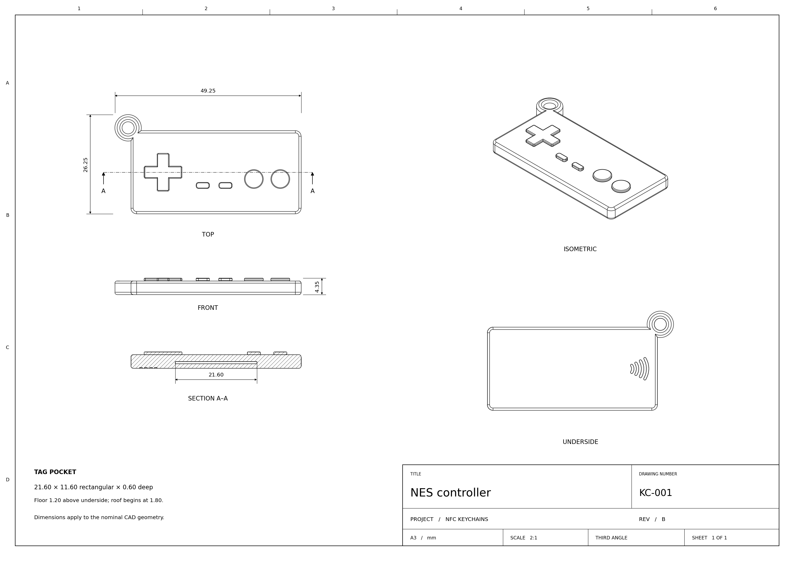

# NFC keychains

Three PLA keychains with an enclosed NFC tag pocket and a flush radio-wave symbol on the back. The STEP files use millimetres and include the housing, front details, and NFC mark as separate solids so they can be assigned different colours.

| Design | Download | Internal pocket dimensions |
| --- | --- | --- |
| NES controller | [STEP](nes-controller.step) | 21.6 × 11.6 × 0.6 mm |
| Floppy disk | [STEP](floppy-disk.step) | Ø25.6 × 0.6 mm |
| Five-row keyboard | [STEP](five-row-keyboard.step) | 21.6 × 11.6 × 0.6 mm |

## Printing and inserting the tag

1. Import one STEP file into your slicer as **one object with multiple parts**. Keep the parts in their imported positions. For the two-colour finish, assign white PLA to the housing and black PLA to the front details and NFC symbol.
2. Place the **flat back with the NFC symbol on the bed**, with the controls, shutter, or keys facing up. A 0.4 mm nozzle and 0.20 mm layers, including the first layer, are a starting point. Keep support generation off so the enclosed pocket stays clear.
3. Measure the entire tag, including any adhesive. Choose one that fits inside the listed pocket and sits below its roof. The pocket floor is 1.20 mm above the bed and the underside of the roof is at 1.80 mm.
4. **Pause immediately before the first toolpath that covers the pocket.** In the sliced preview, find the last layer where the pocket is open and check that the pause runs after that layer. With uniform 0.20 mm layers, this is normally after layer 9 (ending at Z 1.80 mm), before layer 10. Check the preview if your slicer uses a different first-layer height or adaptive layers.
5. At the pause, place the tag flat in the pocket and check that it stays seated below the surrounding plastic. Test it with an NFC reader while the cavity is accessible. Resume printing to seal it in, then test it again after the part cools.

## Engineering drawings

Each A3 sheet includes projected views from the STEP model, an isometric view, and a hatched section A–A through the tag pocket. Dimensions are in millimetres. Print the vector PDFs at actual size (100%) on A3 paper for the stated 2:1 scale.

### NES controller

[Download the A3 drawing (PDF)](drawings/nes-controller.pdf)

### Floppy disk

[Download the A3 drawing (PDF)](drawings/floppy-disk.pdf)

### Five-row keyboard

[Download the A3 drawing (PDF)](drawings/five-row-keyboard.pdf)

