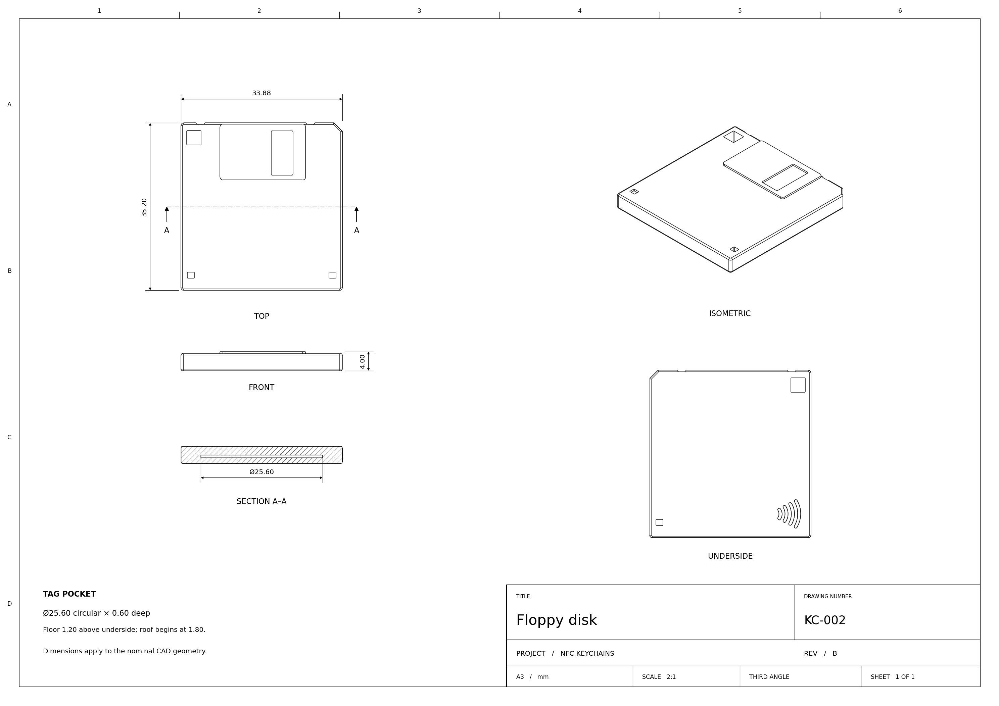
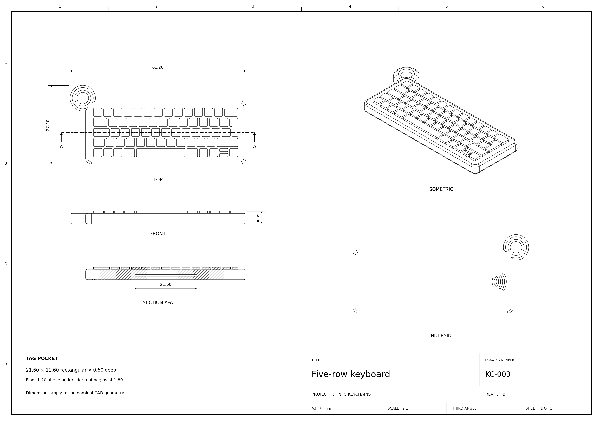

# NFC keychains
Some keychain designs I created for experimenting with NFC tags. The designs are mine and should not be used without permission.

## Tag insertion
In your slicer be sure to add a pause for the tags to be inserted.

## Engineering drawings

Each A3 sheet includes projected views from the STEP model, an isometric view, and a hatched section A–A through the tag pocket. Dimensions are in millimetres. Print the vector PDFs at actual size (100%) on A3 paper for the stated 2:1 scale.

### NES controller

[Download the A3 drawing (PDF)](drawings/nes-controller.pdf)

### Floppy disk

[Download the A3 drawing (PDF)](drawings/floppy-disk.pdf)

### Five-row keyboard

[Download the A3 drawing (PDF)](drawings/five-row-keyboard.pdf)

